# povrayer

POV-Ray 3.8 compiled to WebAssembly. It runs in the browser as a scene editor
that renders while you type, and the same renderer and wrapper also run
headless in Node and as a Docker image.

[](https://github.com/swhitt/povrayer/actions/workflows/ci.yml)
[](https://github.com/swhitt/povrayer/actions/workflows/pages.yml)
[](#license)

Live at [povrayer.com](https://povrayer.com/).

[](https://povrayer.com/)

Rendering happens on your machine. POV-Ray runs multithreaded on
`SharedArrayBuffer`-backed pthreads, and scenes and images stay in the page.

The editor has:

- A low-res draft that re-renders as you edit (debounced), and a Render button
  for the full-quality image.
- SDL syntax highlighting, inline checks for common mistakes, completion,
  find/go-to-line, Alt+drag to scrub numbers, and sliders generated from
  `#declare`s.
- Animation through POV-Ray's `clock` loop, with a frame player and export to
  GIF, APNG, WebM, or numbered PNGs.
- Local images and includes, a render history, trace statistics, and share
  links that compress the scene into the URL.
- Example scenes covering CSG, isosurfaces, radiosity, media, depth of field,
  and animation.
- A [REPL](https://povrayer.com/repl.html) that appends each entry to the scene
  and re-renders, rolling back on error.
- [Turbo](#turbo), a GPU preview that raymarches the same SDL at 60fps.

These were rendered by the CPU tracer in the browser:

<p align="center">
  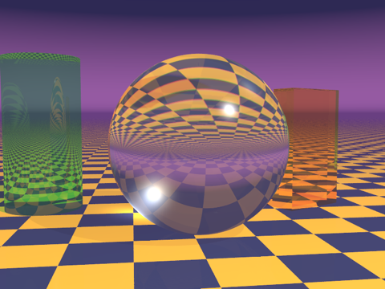
  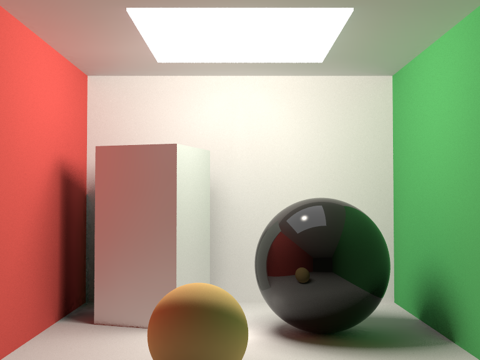
  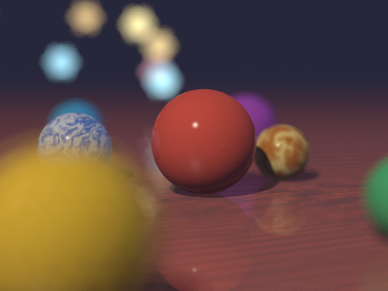
  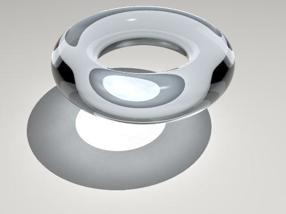
</p>

The same wasm bundle backs the [browser editor](#browser-editor), the
[Docker CLI](#docker), and the [JS API](#js-api).

## Browser editor

The [scene editor](https://povrayer.com/), the
[REPL](https://povrayer.com/repl.html), and [Turbo](#turbo).

<p align="center">
  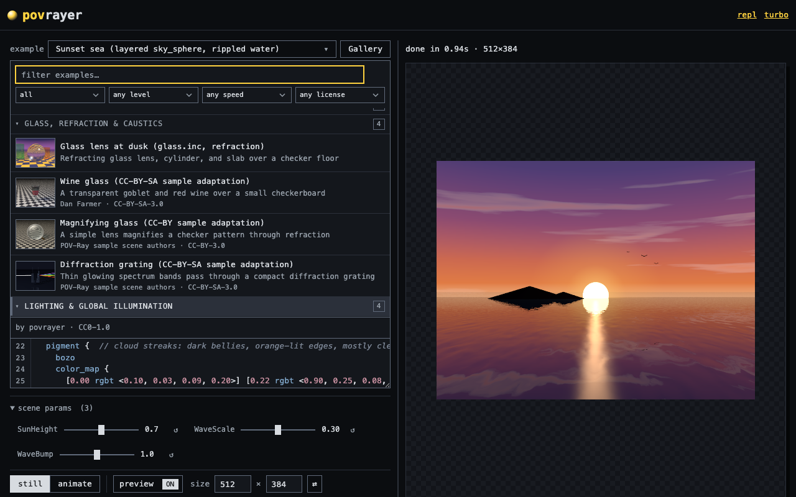
  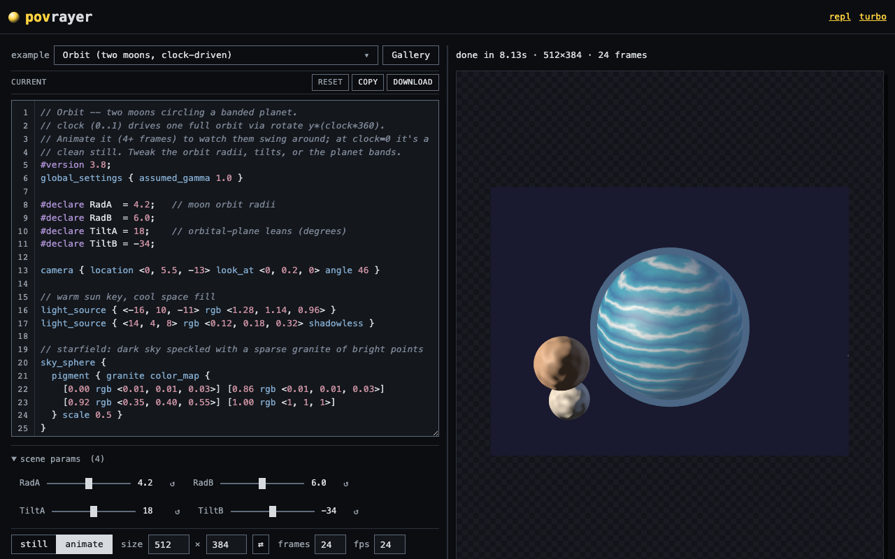
</p>

The REPL shows the assembled scene source in a slide-out panel:

<p align="center">
  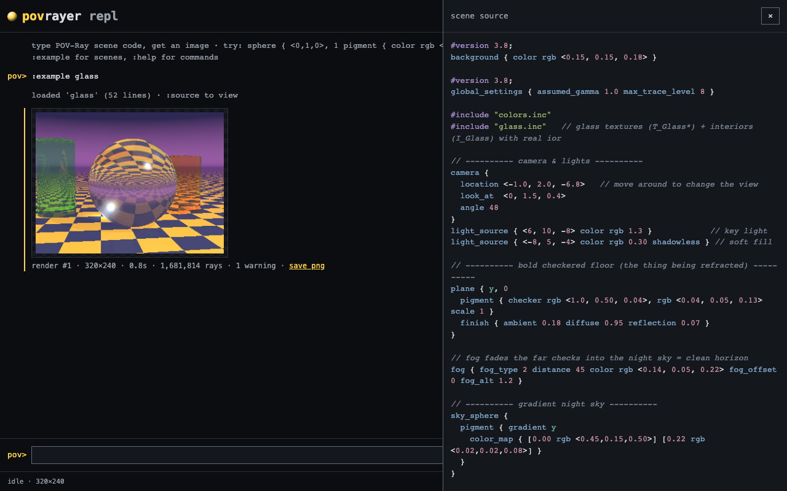
</p>

REPL commands: `:help`, `:reset`, `:list`, `:source`, `:edit N`, `:undo`,
`:del N`, `:size WxH`, `:q N`, `:aa [threshold|off]`, `:threads N`,
`:args [switches]`, `:log [full]`, `:render`, `:anim N`, `:example [name]`,
and `:editor`.

GitHub Pages can't send COOP/COEP headers, so the site uses a vendored
[coi-serviceworker](https://github.com/gzuidhof/coi-serviceworker) for
cross-origin isolation. The first visit reloads once while it installs.

To run it locally, `make web` builds `dist/` if needed and serves the pages at
<http://127.0.0.1:8080/> with COOP/COEP headers set by the server. It binds the
IPv4 loopback only, so use the numeric address rather than `localhost`.

## Turbo

[Turbo](https://povrayer.com/turbo) raymarches POV-Ray SDL on the GPU at the
display's refresh rate when the hardware permits. Editing a number or scrubbing
`clock` updates without recompiling the shader.
**Ray-trace it →** gzips the source into a povrayer permalink and opens it in
the CPU tracer.

[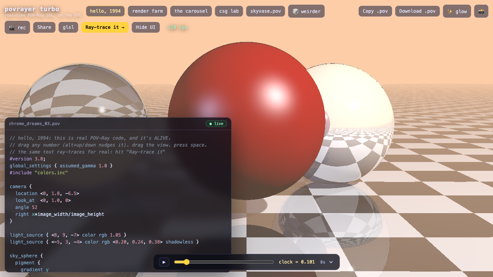](https://povrayer.com/turbo)

The deployed renderer is one generated HTML file with no runtime dependencies
or wasm. A
recursive-descent parser handles a subset of SDL and compiles the scene
structure to GLSL. Numbers go through a uniform buffer every frame, so only
structural edits trigger a recompile, which is debounced and runs in the
background while the old shader keeps drawing.

It follows POV-Ray's conventions where they affect the picture: left-handed
coordinates, `angle` FOV, materials with `interior { ior }` refraction,
exponential fog, and the sky. 95 of the 96 gallery scenes render in Turbo, and
the one that doesn't is handed off to the CPU tracer.
[`docs/turbo.md`](docs/turbo.md) lists what's supported and where it differs.

<p align="center">
  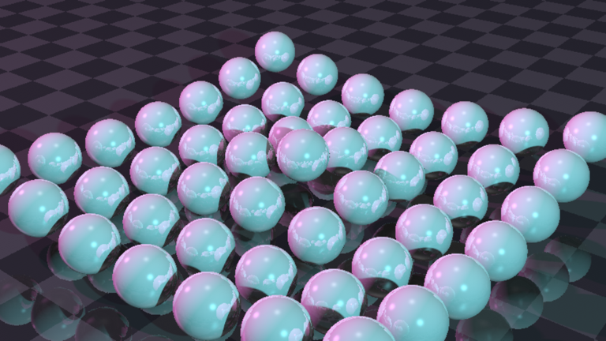
  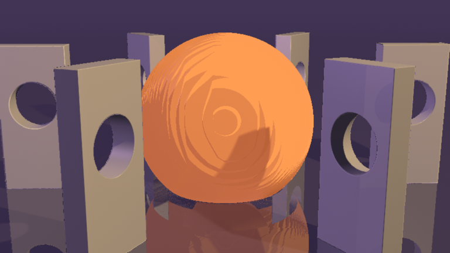
  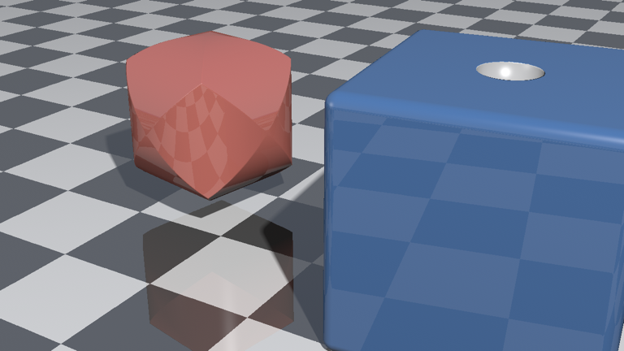
</p>

The `glsl` button shows the generated shader with comments tracing each part
back to the SDL. `✨ glow` adds a second-pass bloom, off by default since
POV-Ray has no equivalent. `📸` and `🎬` save a full-res PNG or a WebM of one
clock loop. On a phone, one finger orbits and two pinch-zoom, and it installs as
a PWA that works offline.

<p align="center">
  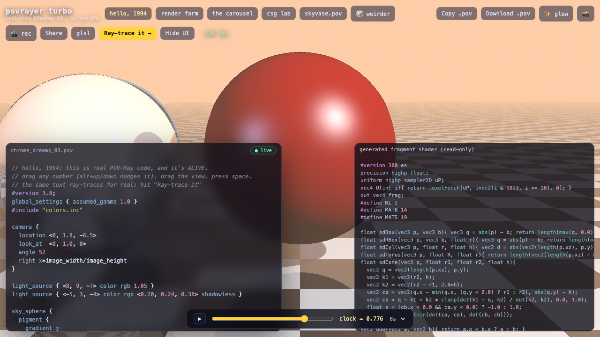
  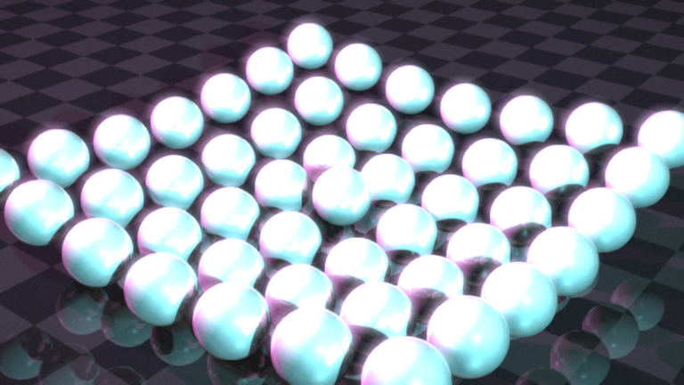
</p>

## Docker

With a mount, so local `.inc` files and textures next to the scene resolve:

```sh
docker run --rm --user "$(id -u):$(id -g)" -v "$PWD:/work" ghcr.io/swhitt/povrayer scene.pov
```

On Linux, `--user` keeps the output PNG from being owned by root.

Without a mount (scene on stdin, PNG on stdout, logs on stderr):

```sh
cat scene.pov | docker run --rm -i ghcr.io/swhitt/povrayer - -o - > out.png
```

Stdin mode has no scene directory, so local includes don't resolve there. The
standard library (`colors.inc`, `textures.inc`, ...) works in both.

Options: `-w N` / `-h N` (size), `-o FILE` (`-` for stdout), `-q N` (quality
0..11), `-a [T]` (antialias, optional threshold), `--threads N`, and `--` to
pass POV-Ray switches through as-is. `--help` lists the rest.

`--frames N` renders an animation. `--clock-initial F` and `--clock-final F`
set the range `clock` sweeps (default 0 to 1). Frames are written as numbered
PNGs: `-o out.png` gives `out01.png`..`outNN.png`, or put a run of `#` in the
name to mark where the number goes. `-o -` isn't allowed with `--frames`.

If the GHCR image isn't available (not public yet, or you're on a fork), build
it with `make image` (or `docker buildx build --target runtime -t povrayer .`)
and use `povrayer` in place of `ghcr.io/swhitt/povrayer`.

## Getting the wasm bundle

```sh
docker buildx build --target artifact --output type=local,dest=dist .
```

`dist/` gets `povray.mjs`, `povray.wasm`, `index.js`, `index.d.ts`, and
`package.json`. The include library is embedded in the wasm, so there's no
`.data` file or separate worker script.

## JS API

`render()` takes SDL source and resolves to the PNG as a new `Uint8Array`
(a copy, not a view into wasm memory):

```js
import { render } from './dist/index.js';

const png = await render(source, {
  width: 800,
  height: 600,
  antialias: 0.3,
  files: { 'shapes.inc': myInclude }, // extra files, staged next to the scene
  onProgress: (line) => console.error(line), // POV-Ray's log, line by line
});
```

POV-Ray execution failures reject with `PovrayError`, which has `exitCode` and
the full log on `.log`; invalid options use validation errors and cancellation
uses `AbortError`. Pass an `AbortSignal` as `signal` to cancel, and additional
POV-Ray switches as `args`. The wrapper rejects input/output, output-format,
and animation-range switches because it owns those paths and frame bounds.

### Animation

`renderAnimation(source, options)` resolves to a `Uint8Array[]`, one PNG per
frame in order, using POV-Ray's clock loop
(`+KFI1 +KFF{frames} +KI{initialClock} +KF{finalClock}`):

```js
import { renderAnimation } from './dist/index.js';

const frames = await renderAnimation(source, {
  frames: 24, // required, integer >= 1
  initialClock: 0, // clock at the first frame (default 0)
  finalClock: 1, // clock at the last frame (default 1)
  onFrame: (index, total) => console.error(`frame ${index}/${total}`),
  // ...plus any render() option (width, antialias, signal, args, files, ...)
});
```

It takes every `RenderOptions` field. An invalid `frames` rejects before
rendering starts.

### Node

Works from `dist/` on Node 20+. Each `render()` call gets its own module
instance and the runtime exits with the render, so leftover worker threads don't
keep the process alive.

### Browser

```html
<script type="module">
  import { render } from '/dist/index.js';
  if (!crossOriginIsolated) throw new Error('serve with COOP/COEP headers');
  const png = await render(source, { width: 320, height: 240 });
  imgEl.src = URL.createObjectURL(new Blob([png], { type: 'image/png' }));
</script>
```

Two requirements:

1. **Cross-origin isolation.** Threads need `SharedArrayBuffer`, so serve the
   page with `Cross-Origin-Opener-Policy: same-origin` and
   `Cross-Origin-Embedder-Policy: require-corp`. If `crossOriginIsolated` is
   false, the wasm won't start.
2. **Don't bundle `povray.mjs`.** Serve `povray.mjs` and `povray.wasm` as
   static files, side by side, with their original names. The pthread workers
   re-import the module through `new URL(import.meta.url)` and ignore
   `locateFile`, so bundling, renaming, or inlining it stops workers from
   starting. Mark it external and copy both files through. `index.js` is fine
   to bundle.

## Build

POV-Ray 3.8, pinned to one upstream commit, is compiled with Emscripten using
pthreads, wasm exception handling, and the standard include library embedded in
the binary. The toolchain is in the `Dockerfile`: the `artifact` stage exports
the bundle and the `runtime` stage is the CLI image. CI builds the bundle from
source on main pushes and pull requests, and `dist/` isn't committed.

## Bundled includes

Besides POV-Ray's standard library (`colors.inc`, `textures.inc`,
`functions.inc`, `rad_def.inc`, ...), the wasm includes
[Lightsys IV](https://www.ignorancia.org/index.php?page=lightsys), in the
browser and the CLI:

```pov
#include "CIE.inc"        // CIE XYZ colour-space macros
#include "lightsys.inc"   // lights from colour temperature / spectra
```

Lightsys IV and the CIE macros are by Jaime Vives Piqueres and "Ive" (bundling
Philippe Debar's Skylight), licensed
[CC-BY-SA-4.0](https://creativecommons.org/licenses/by-sa/4.0/). The build
downloads them from the author's site; they aren't vendored here.

## Memory

The default build allows up to 2GB of shared memory, starting at 256MB. Safari
and iOS can refuse a growable shared memory with a 4GB max, so the browser build
stays at 2GB. The Node CLI image is built with 4GB for large renders. To change
it:

```sh
docker buildx build --build-arg WASM_MAX_MEMORY=4GB --target artifact --output type=local,dest=dist .
```

## Development

```sh
npm ci            # dev deps, and points core.hooksPath at .githooks/
make dist         # build the wasm bundle once (cached); tests render against dist/
npx playwright install chromium  # one-time, for the browser tests
npm test          # node:test render suite + the 4 Playwright browser suites
```

`make hooks` re-wires the git hooks if needed.

### Lint and format

Oxlint (`.oxlintrc.json`) and Prettier (`.prettierrc.json`). The wrapper and web
TypeScript are linted by Oxlint and typechecked by `tsc`.

```sh
npm run lint             # oxlint .
npm run format:check     # prettier --check .
npm run format           # prettier --write .
npm run typecheck        # tsc --noEmit on wrapper/tsconfig.json
npm run typecheck:js     # tsc --noEmit on tsconfig.checkjs.json (web/ + tools/, JS and TS)
npm run typecheck:strict # tsc --noEmit on tsconfig.strict.json (full strict)
npm run build:web        # tsc -p tsconfig.build.json: web/*.ts -> _build/web/*.js
```

`web/` is partway through moving to TypeScript. The `.js` modules are checked
through JSDoc by `tsconfig.checkjs.json` at default `checkJs` strictness (that
file explains why). The `.ts` modules are checked by `tsconfig.strict.json` in
full strict mode, enforced in CI. `test/node/coverage-config.test.mjs` fails if
a module is in neither.

`tools/build-web.mjs` compiles the `.ts` modules into `_build/web/`, since
neither the browser nor Node 20 (still in `engines`, and without
`--experimental-strip-types`) can load TypeScript. Filenames stay the same, so
`index.html` keeps loading `./ui.js`. `test/browser/serve.mjs` serves
`_build/web/` ahead of `web/`, and `tools/assemble-site.mjs` copies it over
`_site`. Both run the build first and it checks its output against the sources,
so a stale module can't be served or shipped. Coverage reports against the `.ts`
source through inline source maps.

A module can only move to `.ts` once its runtime import closure can resolve from
the compiled overlay in `_build/web/`. The remaining `.js` modules stay under
`checkJs` until their dependent group can move together.

### Coverage

One merged report covers every enrolled first-party file across both runtimes.
Node code (`dist/index.js`,
`src/cli.mjs`, `test/browser/serve.mjs`, and the `web/` modules Node tests
import) is measured with c8. Browser modules are measured with Playwright's V8
coverage and converted to istanbul. Both merge into `coverage/`.

`tools/coverage/paths.mjs` defines the file set, so check there rather than this
list. `test/node/coverage-config.test.mjs` requires every `web/` module to be
listed there and in `.c8rc.json` and `tsconfig.checkjs.json`, whatever its
extension, so renaming a file to `.ts` can't drop it out of coverage.

```sh
npm run coverage        # full suite, writes coverage/ (json, lcov, html)
npm run coverage:check  # fails if any first-party file is under 100%
```

Every `c8 ignore` / `istanbul ignore` pragma needs a `-- <reason>`, and the gate
checks for one. Excluded files and why are in `.c8rc.json`.

### Git hooks

In `.githooks/`, wired through `core.hooksPath`:

- **pre-commit:** `prettier --check`, `oxlint`, wrapper typecheck, and the
  DOM-free `test:unit` suite.
- **pre-push:** the same static checks. The full render and browser suites and
  the coverage gate run in CI.

## Docs

- [`docs/turbo.md`](docs/turbo.md): what the SDL-to-GLSL compiler supports and
  where it differs from the CPU tracer, plus presets.
- [`docs/examples.md`](docs/examples.md): generated list of the bundled scenes
  (`npm run gen:examples` rebuilds it from `web/examples.js`).
- [`docs/task-list.md`](docs/task-list.md): the backlog.

## License

The image and the wasm artifact embed POV-Ray 3.8, which is
[AGPL-3.0-or-later](LICENSE), so they are too. This repository is the complete
corresponding source: the Dockerfile and the pinned POV-Ray commit
(`8f9ace11e6587d67c96a3bdfe67893ffbcd5c95e`) reproduce the artifact.
POV-Ray itself is at <https://github.com/POV-Ray/povray>.
