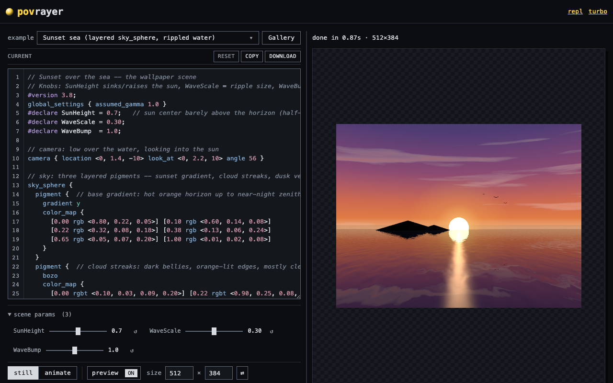

# povrayer

POV-Ray 3.8 compiled to WebAssembly, with a browser editor, a Node API, and a
Docker CLI. Rendering runs locally on CPU threads.

[Editor](https://povrayer.com/) · [REPL](https://povrayer.com/repl.html) ·
[Turbo](https://povrayer.com/turbo)

[](https://github.com/swhitt/povrayer/actions/workflows/ci.yml)

[](https://povrayer.com/)

The editor previews changes as you type. It supports SDL completion, local
textures and includes, render history, and animation through POV-Ray's `clock`.
Animations export as GIF, APNG, WebM, or PNG frames. Share links carry the scene
and settings in the URL.

The REPL builds a scene one entry at a time. Failed entries roll back; `:help`
lists the commands.

Turbo compiles a subset of SDL to GLSL for GPU previews. It approximates some
POV-Ray features; **Ray-trace it** opens the scene in the CPU renderer.
See [Turbo's supported SDL and limitations](docs/turbo.md) and the
[example catalog](docs/examples.md).

## Run locally

Requires Node 26 and Docker. With mise:

```sh
mise install
npm ci
make web
```

Open <http://127.0.0.1:8080/>. The first run builds the WASM bundle in `dist/`.

## Docker

Render a file with its neighboring includes and textures:

```sh
docker run --rm --user "$(id -u):$(id -g)" -v "$PWD:/work" ghcr.io/swhitt/povrayer scene.pov
```

This writes `scene.png`. For stdin input and stdout output:

```sh
docker run --rm -i ghcr.io/swhitt/povrayer - -o - < scene.pov > out.png
```

Logs go to stderr. Local assets require a mounted scene directory; standard
includes are embedded in the renderer.

Use `-w` and `-h` for dimensions, `-q` for quality (0–11), `-a [threshold]` for
antialiasing, `--threads` for thread count, and `-o` for the output path.
`--help` lists all options. Additional POV-Ray switches follow `--`; input,
output-format, output-path, and animation-range overrides are rejected.

`--frames N` renders an animation over `clock` 0 to 1. Change the range with
`--clock-initial` and `--clock-final`. An output path of `out.png` produces
`out01.png`, `out02.png`, and so on. A run of `#` in the path specifies the
number's position and padding. Animation output cannot use stdout.

Build the image locally with `make image`, then use `povrayer` as the image name.

## JavaScript API

Build the bundle with `make dist`. It contains `povray.mjs`, `povray.wasm`,
`index.js`, `index.d.ts`, and `package.json`.

```js
import { render, renderAnimation } from './dist/index.js';

const png = await render(source, {
  width: 800,
  height: 600,
  antialias: 0.3,
  files: { 'shapes.inc': myInclude },
  onProgress: (line) => console.error(line),
});

const frames = await renderAnimation(source, {
  width: 320,
  height: 240,
  frames: 24,
  initialClock: 0,
  finalClock: 1,
});
```

`render()` returns PNG bytes as a `Uint8Array`. `renderAnimation()` returns an
array of PNGs in frame order and accepts the same options, plus `frames`, clock
bounds, and `onFrame(index, total)`. See [the wrapper types](wrapper/src/index.ts)
for all options. The API supports Node 22.13 and Node 24 or later.

Pass an `AbortSignal` as `signal` to cancel. Cancellation rejects with
`AbortError`; renderer failures reject with `PovrayError`, which carries
`exitCode` and the captured output in `log`.

### Browser requirements

Serve the page with these headers so pthreads can use `SharedArrayBuffer`:

```text
Cross-Origin-Opener-Policy: same-origin
Cross-Origin-Embedder-Policy: require-corp
```

Check `crossOriginIsolated` before rendering. On GitHub Pages, the vendored
[coi-serviceworker](https://github.com/gzuidhof/coi-serviceworker) provides
isolation and reloads the first visit once.

Serve `povray.mjs` and `povray.wasm` together with their original names. Keep
`povray.mjs` out of bundlers: pthread workers re-import it using
`new URL(import.meta.url)`. `index.js` can be bundled.

## Build and development

[Dockerfile](Dockerfile) pins POV-Ray and Emscripten. `make dist` exports the
WASM bundle; `make image` builds the CLI image. CI tests the WASM bundle on
main pushes and pull requests and publishes the CLI image after main passes.
Build output is ignored by git.

The browser bundle starts with 256 MB of shared memory and allows growth to
2 GB. The published CLI image allows 4 GB. To build a bundle with that limit:

```sh
docker buildx build --build-arg WASM_MAX_MEMORY=4GB --target artifact --output type=local,dest=dist .
```

The renderer embeds the POV-Ray include library and
[Lightsys IV](https://www.ignorancia.org/index.php?page=lightsys), including
`CIE.inc` and `lightsys.inc`. Lightsys is by Jaime Vives Piqueres and Ive,
includes Philippe Debar's Skylight, and is licensed CC-BY-SA-4.0.

```sh
npx playwright install chromium
npm test
npm run lint
npm run format:check
npm run typecheck
npm run typecheck:js
npm run typecheck:strict
npm run coverage
```

Oxlint checks JavaScript and TypeScript. TypeScript modules use strict checking;
remaining JavaScript uses JSDoc and `checkJs`. `npm run build:web` compiles web
TypeScript into `_build/web/`; the local server and site assembler run it
automatically. After editing Turbo, run `npm run gen:turbo` to update its HTML.

Coverage merges Node and Chromium results. The gate requires 100% coverage for
enrolled files; exclusions and their reasons are in [.c8rc.json](.c8rc.json).
`npm ci` installs git hooks for formatting, lint, wrapper types, and fast tests.
The full suites run in CI.

The [backlog](docs/task-list.md) tracks planned work.

## License

[AGPL-3.0-or-later](LICENSE). The WASM bundle and Docker image embed
[POV-Ray](https://github.com/POV-Ray/povray); this repository contains the build
scripts and patches. Example attribution and licenses are listed in the
[catalog](docs/examples.md).
