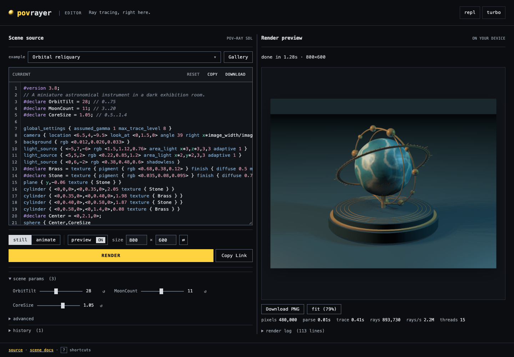

# povrayer

POV-Ray 3.8 compiled to WebAssembly, with a browser editor, a Node API, and a
Docker CLI. Rendering runs locally on CPU threads.

[Editor](https://povrayer.com/) · [REPL](https://povrayer.com/repl.html) ·
[Turbo](https://povrayer.com/turbo)

[](https://github.com/swhitt/povrayer/actions/workflows/ci.yml)

[](https://povrayer.com/)

- **Editor**: live preview as you type, SDL completion, local textures and
  includes, render history, and `clock` animation exported as GIF, APNG, WebM,
  or PNG frames. Share links carry the scene and settings in the URL.
- **REPL**: builds a scene one entry at a time. Failed entries roll back;
  `:help` lists commands.
- **Turbo**: compiles a subset of SDL to GLSL for GPU previews, approximating
  some features. **Ray-trace it** hands the scene to the CPU renderer. See
  [supported SDL and limitations](docs/turbo.md) and the
  [example catalog](docs/examples.md).

## Run locally

Requires Node 26 and Docker. With mise:

```sh
mise install
npm ci
make web
```

Open <http://127.0.0.1:8080/>. The first run builds the WASM bundle in `dist/`.

## Docker

Render a file along with its neighboring includes and textures (writes
`scene.png`):

```sh
docker run --rm --user "$(id -u):$(id -g)" -v "$PWD:/work" ghcr.io/swhitt/povrayer scene.pov
```

Or stdin to stdout:

```sh
docker run --rm -i ghcr.io/swhitt/povrayer - -o - < scene.pov > out.png
```

Logs go to stderr. Standard includes are embedded; local assets need the scene
directory mounted.

Options: `-w`/`-h` dimensions, `-q` quality (0–11), `-a [threshold]`
antialiasing, `--threads`, `-o` output path. `--help` lists the rest. Extra
POV-Ray switches go after `--`; overrides of input, output format, output path,
and animation range are rejected.

`--frames N` renders `clock` from 0 to 1 (adjust with `--clock-initial` and
`--clock-final`). `out.png` becomes `out01.png`, `out02.png`, …; a run of `#`
in the path sets the number's position and padding. Animations can't write to
stdout.

`make image` builds the image locally as `povrayer`.

## JavaScript API

`make dist` builds the bundle: `povray.mjs`, `povray.wasm`, `index.js`,
`index.d.ts`, and `package.json`. Supports Node 22.13 and Node 24+.

```js
import { render, renderAnimation } from './dist/index.js';

const png = await render(source, {
  width: 800,
  height: 600,
  antialias: 0.3,
  files: { 'shapes.inc': myInclude },
  onProgress: (line) => console.error(line),
});

const frames = await renderAnimation(source, {
  width: 320,
  height: 240,
  frames: 24,
  initialClock: 0,
  finalClock: 1,
});
```

`render()` returns PNG bytes as a `Uint8Array`. `renderAnimation()` takes the
same options plus `frames`, clock bounds, and `onFrame(index, total)`, and
returns PNGs in frame order. All options are in
[the wrapper types](wrapper/src/index.ts).

Pass an `AbortSignal` as `signal` to cancel (rejects with `AbortError`).
Renderer failures reject with `PovrayError`, carrying `exitCode` and the
captured output in `log`.

### Browser requirements

Pthreads need `SharedArrayBuffer`, so serve the page with:

```text
Cross-Origin-Opener-Policy: same-origin
Cross-Origin-Embedder-Policy: require-corp
```

Check `crossOriginIsolated` before rendering. On GitHub Pages, the vendored
[coi-serviceworker](https://github.com/gzuidhof/coi-serviceworker) provides
isolation and reloads the first visit once.

Serve `povray.mjs` and `povray.wasm` side by side under their original names,
and keep `povray.mjs` out of bundlers (pthread workers re-import it via
`new URL(import.meta.url)`). `index.js` can be bundled.

## Build and development

The [Dockerfile](Dockerfile) pins POV-Ray (upstream `master`, plus the fixes in
[patches/](patches)) and Emscripten. CI tests the bundle on pushes to main and
on pull requests, and publishes the CLI image once main passes.

The browser bundle starts with 256 MB of shared memory and can grow to 2 GB;
the published CLI image allows 4 GB. To build a bundle with the 4 GB limit:

```sh
docker buildx build --build-arg WASM_MAX_MEMORY=4GB --target artifact --output type=local,dest=dist .
```

The renderer embeds the POV-Ray include library and
[Lightsys IV](https://www.ignorancia.org/index.php?page=lightsys) (`CIE.inc`,
`lightsys.inc`) by Jaime Vives Piqueres and Ive, which includes Philippe
Debar's Skylight. Lightsys is licensed CC-BY-SA-4.0.

```sh
npx playwright install chromium
npm test
npm run lint
npm run format:check
npm run typecheck && npm run typecheck:js && npm run typecheck:strict
npm run coverage
```

TypeScript modules are strict; the remaining JavaScript is checked through
JSDoc and `checkJs`. Web TypeScript compiles to `_build/web/` (`npm run
build:web`, run automatically by the local server and site build). After
editing Turbo, run `npm run gen:turbo` to regenerate its HTML.

Coverage merges Node and Chromium results and requires 100% for enrolled files;
exclusions and reasons live in [.c8rc.json](.c8rc.json). `npm ci` installs git
hooks for formatting, lint, wrapper types, and fast tests; the full suites run
in CI.

The [backlog](docs/task-list.md) tracks planned work.

## License

[AGPL-3.0-or-later](LICENSE). The WASM bundle and Docker image embed
[POV-Ray](https://github.com/POV-Ray/povray); this repo holds the build scripts
and patches. Example attribution and licenses are in the
[catalog](docs/examples.md).
